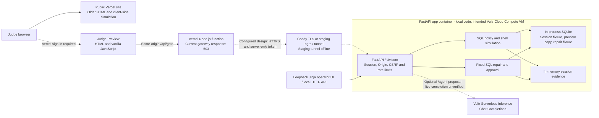

# Veylix RepairLab

AI agents can propose routine database work and destructive changes through the same interface. A developer reviewing only the command has little evidence about what it would affect or whether a proposed repair would actually work. Veylix RepairLab gives startup engineers, indie developers, and operators a place to inspect a proposal, review its scope, and compare the measured result with the plan.

The hackathon prototype has two workflows. **RepairLab** reproduces a failed sample job, proposes a fixed one-row repair, and waits for approval before updating the sample and rerunning the failed query. **Scenario review** shows the effects of selected SQL proposals on fictional data and simulates shell and cloud actions. The public landing page uses the **Veylix Gate** name.

## Judge access and release status

Audit date **9 November 2026 (IST)**. Source under review is [`a59d08e8ccecaf1308dbafefb70b9b06a22c85c3`](https://github.com/Shajith-Primacytech/veylix-gate/tree/a59d08e8ccecaf1308dbafefb70b9b06a22c85c3) on `codex/judge-live-repair`. GitHub's default branch is `main`. The judge Preview is associated with this source commit. The public landing page HTML matched the older `c266987ec768b47a26f01e1e6498b22545006980` version byte for byte.

| Surface | Verified status |
| --- | --- |
| [Public Vercel demo](https://veylix-gate-demo.vercel.app/) | Homepage **200**. **Try the 60-second safety demo** opens the browser simulation. Select the customer read, customer table removal, or mock volume scenario and inspect its displayed impact. The session and repair gateway routes return **404**. |
| [Judge repair Preview](https://veylix-gate-demo-wap070w1g-shajiths-projects-8ad4c5d5.vercel.app/) | Anonymous traffic redirects to Vercel sign-in (**302**). Authorized access returned **200** for the page and JavaScript. **Try a Live Repair** is the repair entry point. Session and repair API requests returned **503** with `Demo gateway is not configured`, before an upstream request. |
| Vultr Cloud Compute | The intended staging orchestrator is FastAPI on a Vultr VM. Its assigned ngrok tunnel returned **404 / ERR_NGROK_3200** for health and direct audit. Standard HTTP and HTTPS probes to the recorded VM addresses timed out. The running VM revision and service state remain unverified. |
| Vultr Serverless Inference | The application has one LLM call path and targets Vultr's Chat Completions endpoint. Provider behavior is tested with mocks. The rehearsal recorded an unconfigured inference error, and a live provider completion remains unverified. |
| Challenge 1 launch | **NO-GO.** The working public surface is the Vercel simulation. Vultr-hosted web delivery, a reachable Vultr orchestrator, successful live inference, and a separate task sandbox with recorded containment are outstanding. [LabLab Challenge 1 requirements](https://lablab.build/ai-hackathons/vultr-hackathon?track=c1-blast-radius-zero) |

The public simulation can be explored without credentials. The repair Preview requires authorized Vercel access and, once connected, a separate organizer-issued demo code. For a working repair today, use the local steps below. A connected public judge URL with live repair and audit access has yet to be verified.

## Architecture and service boundaries



- **Vercel** serves the public landing page and the protected judge Preview. The newer Preview includes a Node.js gateway with exact method and route allowlists, HTTPS and same-origin mutation checks, scoped cookie forwarding, and an upstream timeout. The browser uses the same origin. The gateway attaches a server-only proxy token for FastAPI. A cross-origin Preview preflight returned **404** without CORS allow headers, and a foreign-Origin POST was rejected with **403**.
- **Vultr Cloud Compute** is the documented VM target for the FastAPI orchestrator. The Caddy Compose option terminates HTTPS on ports 80/443 and forwards to the private app service. The alternate staging Compose file uses an outbound ngrok tunnel without publishing host ports. The packaged FastAPI root route returns the Jinja operator UI only in loopback mode. The checked-in VM recipes serve the backend and do not publish the Vercel browser bundle on Vultr.
- **Vultr Serverless Inference** is the sole implemented LLM provider. `POST /agent` calls `https://api.vultrinference.com/v1/chat/completions` using an API key and configured model on the backend. The returned JSON proposal is validated and routed through the policy gate. A successful response reports provider, model and completion ID. The guided repair uses deterministic SQL and makes zero LLM calls. [Vultr Chat Completions](https://docs.vultr.com/products/compute/serverless-inference/management/usage/chat)
- **SQLite** stores fictional data in process memory. Each signed-in session gets 250 customers, 1,200 orders, two mock volumes, its own pending decisions and audit activity, and at most one current repair workload. There is no managed database or Vultr Block Storage integration.

The backend routes are `GET /healthz`, `GET /` for the local operator, `GET/POST /session`, `POST /logout`, `POST /action`, `POST /agent`, `POST /approve/{id}`, `POST /reject/{id}`, `GET /api/pending`, `GET /api/audit`, and the `/api/repair` route family. Health is public on the backend and reports liveness only. The Vercel gateway forwards the demo API routes and excludes backend health and the operator page.

## Execution lifecycle and safety boundaries

| Control | Implemented behavior and limit |
| --- | --- |
| Execution isolation | Docker packages the **FastAPI application** as a single Uvicorn worker. SQL executes in that worker. There is no per-action Docker container, separate execution process, generated-code runner, or browser executor. |
| SQL policy | SQLGlot classifies supported single statements. SQLite authorizer rules restrict normal queries to supported fixture tables and functions. Mutations are previewed on a disposable in-memory copy. Safe reads and permitted scoped mutations can execute on the session fixture. Broad mutations and the allowlisted DROP enter review. Approval in the scenario picker records a simulated result. Shell actions are classified and simulated without invoking a shell. |
| Resource controls | The SQL path uses a roughly 200 ms SQLite progress-handler deadline, SQLite limits, and capped query output of 100 rows or approximately 64 KiB. The API caps request bodies, sessions and request rates. The Docker configuration defines no task-specific CPU, memory, PID, disk or wall-clock enforcement. |
| Secrets and privileges | The app image runs as UID/GID 10001 with a read-only root filesystem in Compose. It has no Docker socket or fixture data mount. Gateway and inference credentials are supplied server-side. Because the SQL executor shares the app process, there is no independent task environment or OS boundary for secrets and privileges. |
| Network | The app service has no published host port in the supplied Compose files. It can make outbound HTTPS inference calls. The recipes define no per-task egress-deny network policy. Origin and CSRF checks are browser request controls. |
| Cleanup and evidence | SQLite preview copies close after inspection. The current repair database closes when replaced, and session databases close on logout or expiry. Sessions expire after 30 minutes and are discarded on process restart. The repair export is an unsigned snapshot of in-memory server evidence. It includes UTC timestamps, run and event IDs, a pseudonymous actor, the SQL plan, and measured results. Export it before replacing the run or ending the session. |

**Planned for a Challenge 1 release.** Execute each supported task in a fresh worker on Vultr with no application credentials or host mounts, restricted privileges, explicit egress policy, CPU/memory/PID/storage and wall-clock caps, and reliable teardown. Record the task, applicable policy, measured result, blocked boundary and cleanup outcome. Publish the judge web app on Vultr and verify the entire flow there.

## Example repair and audit evidence

1. Open **Try a Live Repair** on a connected judge build, or use the local API below. Start sample job **7**. The fixture contains jobs 1 through 20 and seeds job 7 disabled. The actual query `SELECT id FROM repair_jobs WHERE id = ? AND enabled = 1` returns zero rows.
2. Select **Request diagnosis**. The server confirms job 7 is disabled and presents `UPDATE repair_jobs SET enabled = 1 WHERE id = ? AND enabled = 0`, bound to job 7. The plan expects one updated row and one returned row on the rerun. Approval expires after five minutes.
3. Select **Approve and rerun**. The server rechecks the failed state, updates the row, reruns the same workload, and commits only if both measurements match. Failed verification rolls back the transaction. **Reject repair** records the rejection without updating the fixture.
4. In **Server audit timeline**, inspect **Failure reproduced**, **Awaiting your decision**, **Repair approved**, and **Repair verified and committed**. **Download redacted evidence** exports the same run data. Compare the run ID and ordered events with `GET /api/repair`. The final event should report `mode: sqlite-fixture`, `rows_updated: 1`, one row returned on rerun, and `committed: true`. A separate session gets no current run and receives **404** if it tries to decide this run.

## Recorded demonstration

The local team rehearsal, `artifacts/veylix-hackathon-rehearsal-silent.mp4` (3:17.77), contains a real **SQLite policy and approval demonstration**. At **1:00.10–1:26.03**, the DROP preview on an in-memory copy reports a foreign-key failure and the operator rejects the proposal. The following volume example is a simulation. At **2:25.37–2:50.77**, the recording shows job 7 failing, the approved one-row repair and the successful rerun. The audit timeline follows at **2:50.77–3:09.77**.

The retained local export `artifacts/veylix-local-audit-evidence.json` contains the SQL rejection and its preview error, the simulated volume rejection, and the job 7 before/after and commit evidence. With the original files, compare those timestamps to the clip and inspect the relevant events using the commands below. The files are local team artifacts. A public recording link and a recorded OS/container containment run on Vultr remain outstanding. The rehearsal's approval boundary is at the SQLite and application-policy layers.

```sh
ffprobe -v error -show_entries stream=codec_type,width,height:format=duration \
  -of compact artifacts/veylix-hackathon-rehearsal-silent.mp4
jq '.repair | {mode, before, audit: [.audit[] | {status, evidence}]}' \
  artifacts/veylix-local-audit-evidence.json
jq '.scenario_activity[] | select(.decision == "rejected") | {kind, decision, blast_radius}' \
  artifacts/veylix-local-audit-evidence.json
```

## Run locally

Use Python 3.12 and Node.js 24. `curl` and `jq` are used in the API walkthrough.

```sh
python3.12 -m venv .venv
. .venv/bin/activate
python -m pip install -r requirements.txt pytest

# Public sample value for loopback only. Use independent random secrets on any hosted environment.
export GATE_LOCAL_ORIGIN=http://127.0.0.1:8000
export GATE_DEMO_ACCESS_CODE=local-sample-access-code-0123456789
unset GATE_PROXY_TOKEN GATE_ALLOWED_ORIGINS VULTR_INFERENCE_API_KEY VULTR_INFERENCE_MODEL
uvicorn app:app --host 127.0.0.1 --port 8000 --no-proxy-headers
```

Open [the local operator UI](http://127.0.0.1:8000/) and enter the sample access code. The Jinja UI exposes the scenario workflow. Use the following in a second shell for the guided repair. It writes only disposable sample data and removes its local session cookie file on exit.

```sh
(
  set -eu
  base=http://127.0.0.1:8000
  jar=$(mktemp)
  trap 'rm -f "$jar"' EXIT
  csrf=$(curl -fsS -c "$jar" -H "Origin: $base" -H 'Content-Type: application/json' \
    --data '{"access_code":"local-sample-access-code-0123456789"}' "$base/session" | jq -er .csrf)
  post() {
    curl -fsS -b "$jar" -H "Origin: $base" -H "X-CSRF-Token: $csrf" \
      -H 'Content-Type: application/json' --data "$2" "$base/$1"
  }
  run=$(post api/repair/start '{"job_id":7}' | jq -er .run.run_id)
  post api/repair/diagnose "{\"run_id\":\"$run\"}" | jq '.run.plan'
  post api/repair/decide "{\"run_id\":\"$run\",\"decision\":\"approve\"}" | jq '.run.audit[-1]'
  curl -fsS -b "$jar" "$base/api/repair" | jq '.run | {mode, status, before}'
  post logout '{}' >/dev/null
)
```

## Reproduce the release checks

The audit ran **40 Python tests** (one Starlette/httpx deprecation warning), **4 Node gateway tests**, Python compilation, JavaScript syntax checks, both Compose configuration checks, and a local Vercel Preview build in a temporary directory. The repo has no dedicated lint script. The Docker image runtime build was blocked by an unavailable local Docker daemon. The loopback HTTP smoke test exercised health, login, Origin enforcement, sample count, repair, isolation between sessions, and logout. The preview authorization check used existing Vercel access.

```sh
git rev-parse HEAD
git status --short
python -m pytest -q
node --test tests/proxy.test.mjs
python -m compileall -q app.py agent.py database.py gate.py repair.py
node --check web/demo.js
node --check web/api/gate.mjs
git diff --check

# Validate Compose with placeholders and no daemon or deployment.
(
  export GATE_PROXY_TOKEN=local-placeholder-proxy-token-0123456789
  export GATE_DEMO_ACCESS_CODE=local-placeholder-access-code-0123456789
  export GATE_ALLOWED_ORIGINS=https://example.invalid
  export GATE_BACKEND_HOST=example.invalid
  export NGROK_AUTHTOKEN=placeholder-for-config-only
  docker compose -f docker-compose.yml config --quiet
  docker compose -f docker-compose.tunnel.yml config --quiet
)

# Run from an authorized, locally linked copy of web/ with the Other preset.
# This generates a local build output.
vercel build
```

Safe HTTP probes. The protected Preview's application responses require existing authorized Vercel CLI access. The backend probes require the assigned staging HTTPS origin from the operator.

```sh
public=https://veylix-gate-demo.vercel.app
preview=https://veylix-gate-demo-wap070w1g-shajiths-projects-8ad4c5d5.vercel.app
curl -sS -o /dev/null -w '%{http_code}\n' "$public/"
curl -sS -o /dev/null -w '%{http_code}\n' "$public/api/gate?route=session"
curl -sS -o /dev/null -w '%{http_code}\n' "$preview/"
vercel curl "$preview/api/gate?route=session" -- -sS -w '\n%{http_code}\n'
vercel curl "$preview/api/gate?route=api%2Frepair" -- -sS -w '\n%{http_code}\n'
vercel curl "$preview/api/gate?route=session" -- -sS -D - -o /dev/null -X OPTIONS \
  -H 'Origin: https://example.invalid' -H 'Access-Control-Request-Method: POST' \
  -H 'Access-Control-Request-Headers: content-type,x-csrf-token'

# On reachable staging, expect health 200 and unauthenticated direct audit 403.
curl --max-time 10 -sS -o /dev/null -w '%{http_code}\n' "${STAGING_ORIGIN:?Set the staging HTTPS origin}/healthz"
curl --max-time 10 -sS -o /dev/null -w '%{http_code}\n' "$STAGING_ORIGIN/api/audit"
```

For staging, FastAPI requires `GATE_DEMO_ACCESS_CODE`, `GATE_PROXY_TOKEN`, and the exact browser origin in `GATE_ALLOWED_ORIGINS`. Caddy or ngrok uses `GATE_BACKEND_HOST`, and the tunnel also uses `NGROK_AUTHTOKEN`. The Vercel gateway requires `GATE_BACKEND_ORIGIN` as a bare HTTPS origin and a matching `GATE_PROXY_TOKEN`. Vultr inference requires `VULTR_INFERENCE_API_KEY` and `VULTR_INFERENCE_MODEL` on the backend. Keep all credentials in the authorized secret store. [Staging operator runbook at the audited revision](https://github.com/Shajith-Primacytech/veylix-gate/blob/a59d08e8ccecaf1308dbafefb70b9b06a22c85c3/README.md#stage-the-feature-branch)
